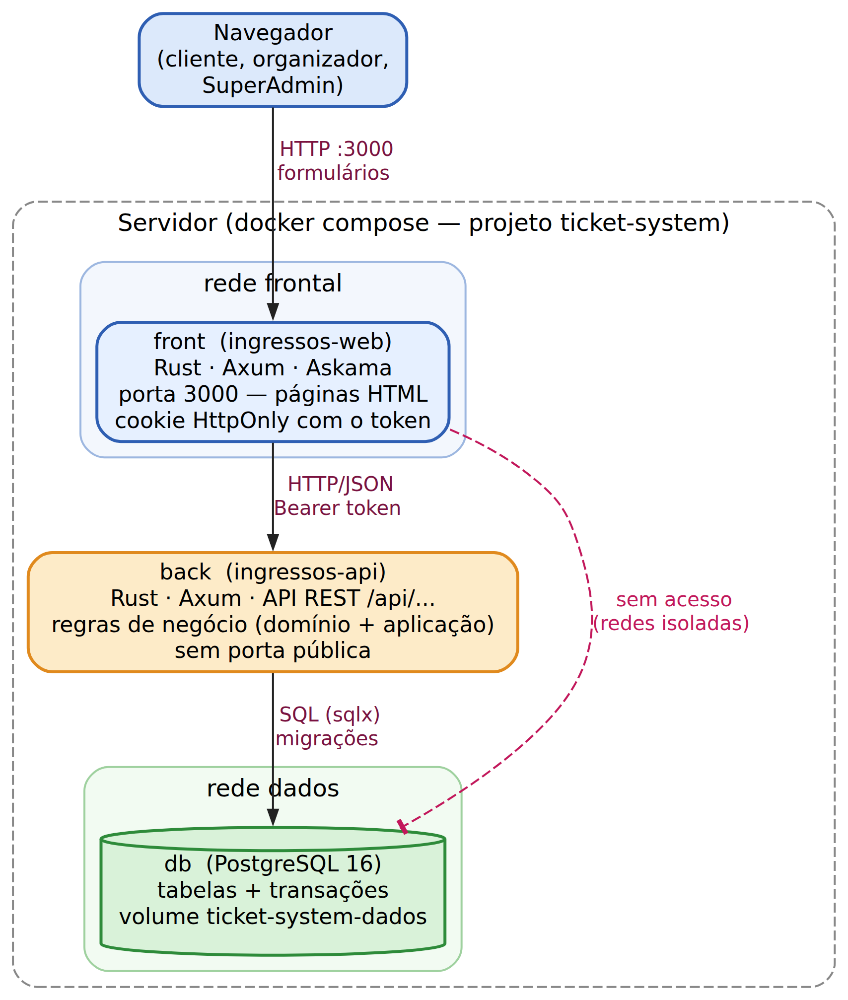
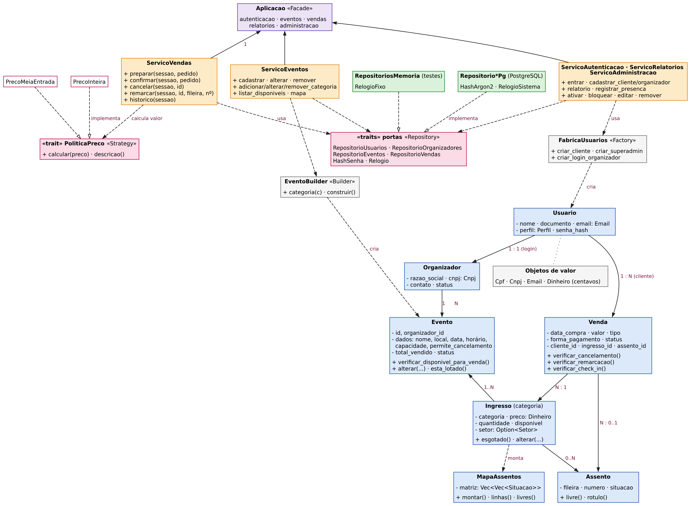

# 10. Organização do programa e POO

## 10.1 Organização em camadas

O código fica na pasta `codigo/` e é um *workspace* Rust dividido em seis pacotes (*crates*). Cada
camada só conhece as camadas mais internas. Essa é a ideia da arquitetura limpa (ou hexagonal):
as regras de negócio não dependem de banco de dados nem de interface.

| Camada | Pacote | Responsabilidade |
|---|---|---|
| Domínio | `dominio` | Entidades, objetos de valor, regras (validações) e as interfaces (`trait`s) dos repositórios |
| Aplicação | `aplicacao` | Casos de uso: um serviço por grupo de algoritmos da seção 8 |
| Infraestrutura | `infraestrutura` | Implementações das interfaces: PostgreSQL, memória (testes), Argon2, relógio |
| Contrato | `contrato` | Formatos das mensagens trocadas entre o front e o back (JSON) |
| Back-end | `api` | API REST: recebe pedidos HTTP, chama os serviços e devolve JSON |
| Front-end | `web` | Páginas HTML: formulários, mapa de assentos e chamadas ao back |

## 10.2 Classes, objetos, atributos e métodos

Rust não tem a palavra `class`. Uma classe é escrita como uma `struct` (atributos) mais um bloco
`impl` (métodos). Os objetos são criados por funções construtoras que validam os dados, e não é
possível criar um objeto inválido.

| Classe | Principais atributos | Principais métodos |
|---|---|---|
| `Usuario` | nome, documento, email (`Email`), perfil, senha_hash | `perfil()`, `email()` |
| `Organizador` | razão social, cnpj (`Cnpj`), contato, status | `esta_ativo()`, `ativar()`, `bloquear()`, `editar()` |
| `Evento` | dados (nome, local, data, horário, capacidade), total vendido, status | `verificar_disponivel_para_venda()`, `alterar()`, `esta_lotado()` |
| `Ingresso` (categoria) | categoria, preço (`Dinheiro`), quantidade, disponível, setor | `esgotado()`, `alterar()`, `com_assento()` |
| `Assento` | setor, fileira, número, situação | `livre()`, `rotulo()` |
| `MapaAssentos` | matriz de situações | `montar()`, `linhas()`, `livres()` |
| `Venda` | data, valor, tipo, forma de pagamento, status, ids | `verificar_cancelamento()`, `verificar_remarcacao()`, `verificar_check_in()` |
| `RelatorioEvento` | vendidos, cancelados, presentes, receita, ocupação | `calcular()` |
| `ServicoVendas` | repositórios de eventos e vendas, relógio | `preparar()`, `confirmar()`, `cancelar()`, `remarcar()` |

**Relacionamentos:** um organizador tem N eventos; um evento é composto por 1..N categorias; uma
categoria tem 0..N assentos; uma venda pertence a um cliente e a uma categoria e, quando houver, a
um assento. A `Aplicacao` é composta pelos cinco serviços.

## 10.3 Pilares da orientação a objetos

- **Encapsulamento:** os atributos são privados e só mudam por métodos que conferem as regras.
  Exemplo: a `Venda` só muda de situação por `marcar_cancelada()` ou `marcar_utilizada()`, e o
  `Dinheiro` não aceita valor negativo.
- **Abstração:** as interfaces `RepositorioEventos`, `RepositorioVendas`, `HashSenha` e `Relogio`
  descrevem *o que* é feito, sem dizer *como*.
- **Polimorfismo:** a mesma chamada `politica.calcular(preco)` executa a regra da inteira ou da
  meia-entrada, conforme o objeto. Os repositórios PostgreSQL e em memória também são usados pelo
  mesmo código, sem que os serviços saibam qual está ativo.
- **Herança:** Rust não tem herança de classes. Usamos **composição** (o `Evento` contém
  `DadosEvento`; a `Aplicacao` contém os serviços) e **implementação de interfaces** (`trait`), que
  é a forma recomendada pela própria linguagem.

## 10.4 Princípios SOLID

| Princípio | Como aparece no projeto |
|---|---|
| **S** — Responsabilidade única | Cada serviço cuida de um grupo de algoritmos; cada repositório, de uma tabela |
| **O** — Aberto/fechado | Um novo tipo de ingresso entra como uma nova `PoliticaPreco`, sem mudar a venda |
| **L** — Substituição de Liskov | `RepositoriosMemoria` e os repositórios PostgreSQL passam pelos mesmos testes |
| **I** — Segregação de interfaces | Interfaces pequenas e separadas por assunto (usuários, organizadores, eventos, vendas) |
| **D** — Inversão de dependência | Os serviços dependem só das interfaces; as implementações são injetadas no `main.rs` |

## 10.5 Padrões de projeto

| Padrão | Onde | Para quê |
|---|---|---|
| Repository | `dominio/src/portas.rs` + `infraestrutura/` | Separar as regras do acesso ao banco |
| Strategy | `dominio/src/precos.rs` | Cálculo do preço da inteira e da meia-entrada |
| Builder | `EventoBuilder` | Montar o evento com as categorias e conferir a capacidade no fim |
| Factory | `FabricaUsuarios` | Criar clientes, organizadores e SuperAdmin já validados e com a senha em hash |
| Facade | `Aplicacao` | Um ponto de entrada único para os casos de uso |
| Injeção de dependência | `Dependencias` + `api/src/main.rs` | Trocar PostgreSQL por memória nos testes |
| Value Object | `Cpf`, `Cnpj`, `Email`, `Dinheiro` | Valor que só existe se for válido |
| Remote Facade / DTO | `contrato` + `web/src/backend.rs` | O front chama o back por HTTP com os mesmos nomes de métodos |
| Post/Redirect/Get | rotas do front | Evitar compra repetida ao recarregar a página |
