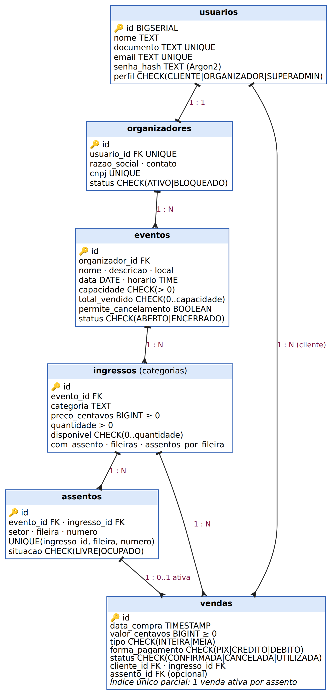

# 13. Persistência e armazenamento de dados

## 13.1 Banco de dados e SGBD

Os dados ficam no **PostgreSQL 16**, que roda em um contêiner próprio com um volume do Docker
(`ticket-system-dados`). Assim, os dados continuam lá quando os contêineres são reiniciados ou
atualizados. Só o back-end acessa o banco, e o front não está na mesma rede que ele.

A estrutura é criada por **migrações** (`codigo/migrations/*.sql`), aplicadas automaticamente quando
o back inicia. Se o banco estiver vazio, o back cadastra dados de demonstração ou apenas o
SuperAdmin definido no `.env`, conforme a configuração.

## 13.2 Tabelas



| Tabela | Conteúdo | Principais restrições |
|---|---|---|
| `usuarios` | Login de clientes, organizadores e SuperAdmin | `email` e `documento` únicos; perfil limitado a 3 valores |
| `organizadores` | Empresa ligada a um usuário | `cnpj` único; status ATIVO ou BLOQUEADO |
| `eventos` | Dados do evento | `capacidade > 0`; `total_vendido` entre 0 e a capacidade |
| `ingressos` | Categorias do evento (Pista, Cadeira...) | `preco_centavos ≥ 0`; `disponivel` entre 0 e a quantidade |
| `assentos` | Cada lugar da matriz | Único por categoria, fileira e número; LIVRE ou OCUPADO |
| `vendas` | Compras | Índice único parcial: no máximo uma venda ativa por assento |

As restrições do banco repetem as regras da seção 7.3. Mesmo que um erro escapasse da validação no
programa, o banco recusaria o dado inválido.

## 13.3 Operações SQL

| Operação | Exemplo |
|---|---|
| Inserir | `INSERT INTO vendas (...) VALUES (...) RETURNING id` |
| Consultar | `SELECT ... FROM vendas v JOIN ingressos i ON ... WHERE v.cliente_id = $1` |
| Atualizar com condição | `UPDATE assentos SET situacao = 'OCUPADO' WHERE id = $1 AND situacao = 'LIVRE'` |
| Remover | `DELETE FROM eventos e WHERE e.id = $1 AND NOT EXISTS (...vendas...)` (só sem vendas) |

Todos os valores entram por **parâmetros** (`$1`, `$2`...), nunca colados no texto do SQL. Isso
impede a injeção de SQL.

## 13.4 Transações: como a venda duplicada é evitada

A compra (Alg. 4) grava tudo em uma **transação**: ou todas as alterações acontecem, ou nenhuma. Cada
`UPDATE` só altera a linha se a condição ainda for verdadeira no momento da gravação. Se dois clientes
tentarem o mesmo assento ao mesmo tempo, só o primeiro consegue, e o segundo recebe "assento já
vendido":

```
INICIAR TRANSAÇÃO
  UPDATE assentos SET situacao = 'OCUPADO' WHERE id = $1 AND situacao = 'LIVRE'     -- 0 linhas → erro
  UPDATE ingressos SET disponivel = disponivel - 1 WHERE id = $1 AND disponivel > 0  -- 0 linhas → esgotado
  UPDATE eventos SET total_vendido = total_vendido + 1
                 WHERE id = $1 AND total_vendido < capacidade                         -- 0 linhas → lotado
  INSERT INTO vendas (...) VALUES (...)
CONFIRMAR TRANSAÇÃO
```

O cancelamento (Alg. 5), a remarcação (Alg. 5b) e o autocadastro de organizador (Alg. 9) também usam
transações.

## 13.5 Dados durante a execução

Nos testes automáticos, os mesmos repositórios são implementados **em memória** (listas `Vec`
protegidas por um `Mutex`). Assim, os testes rodam sem banco e sempre com o mesmo resultado, e os
mesmos cenários também rodam no PostgreSQL real no pipeline de CI.
